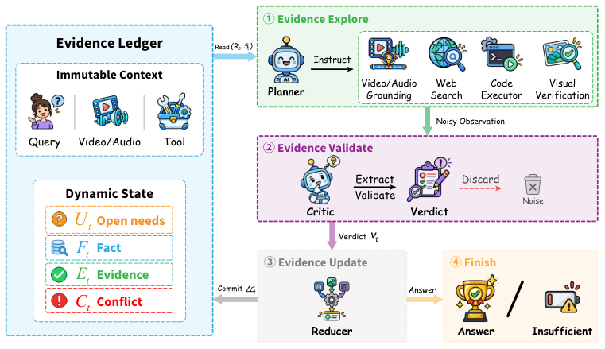

<p align="center">
  <a href="https://mbjinx.github.io/omnidecision_web/"></a>
</p>

<h1 align="center">Omni-Decision</h1>
<p align="center"><strong>Evidence-Ledger Planning for Omni-Modal Agents</strong></p>

<p align="center">
  Ming Ma<sup>1,2</sup> · Yi Zhu<sup>3,*</sup> · Yiran Zhong<sup>3,*</sup> · Feida Zhu<sup>3</sup> · Yuhao Wang<sup>4</sup><br>
  Junhan Shi<sup>5</sup> · Lingrui Mei<sup>6</sup> · Tianming Yang<sup>1</sup> · Steven Hoi<sup>3</sup>
</p>
<p align="center">
  <sub>
    <sup>1</sup>Institute of Neuroscience, Chinese Academy of Sciences ·
    <sup>2</sup>University of Chinese Academy of Sciences ·
    <sup>3</sup>Tongyi Lab, Alibaba Group<br>
    <sup>4</sup>Shanghai Jiao Tong University ·
    <sup>5</sup>Tsinghua University ·
    <sup>6</sup>Institute of Computing Technology ·
    <sup>*</sup>Corresponding authors
  </sub>
</p>

<p align="center">
  <a href="https://arxiv.org/abs/2607.11433"></a>
  <a href="https://mbjinx.github.io/omnidecision_web/"></a>
  <a href="https://mbjinx.github.io/omnidecision_web/#demo"></a>
  <a href="LICENSE"></a>
  
  <a href="https://github.com/MBJinX/OmniDecision/stargazers"></a>
</p>

<p align="center">
  <a href="#-overview">Overview</a> ·
  <a href="#-results">Results</a> ·
  <a href="#-installation">Installation</a> ·
  <a href="#-quick-start">Quick start</a> ·
  <a href="#-trace-viewer">Trace viewer</a> ·
  <a href="#-repository-layout">Layout</a> ·
  <a href="#-citation">Citation</a>
</p>

<p align="center">
  <a href="https://arxiv.org/html/2607.11433v3#S2.F2"></a>
</p>

## 📰 News

- **2026-11** — Inference code and the local trace viewer are released.
- **2026-07** — The paper is available on [arXiv](https://arxiv.org/abs/2607.11433).

## 🔍 Overview

Omni-modal agents must gather evidence across video, audio, web pages and
computation. As noisy observations pile up in the dialogue history, later
planning decisions degrade. Omni-Decision replaces that growing history with an
explicit **evidence ledger** kept for each question.

- **Evidence ledger.** The ledger records which evidence needs are still open,
  what has been confirmed, the derived facts, and any unresolved conflicts.
- **Planner.** At each step the planner reads the open needs and selects the
  next tool call.
- **Critic and reducer.** The critic checks every observation, and the reducer
  writes only the usable content back to the ledger, so the planner's context
  stays compact for the whole task.
- **Inspectable traces.** Each run logs the state, action and verdict for every
  step. The bundled viewer replays these traces.

## 📊 Results

Accuracy (%) on the 360 questions of [OmniGAIA](https://arxiv.org/abs/2602.22897).
The best score in each column is in bold.

| Method | Overall | Easy | Medium | Hard |
| :--- | :---: | :---: | :---: | :---: |
| Gemini-3-Pro <sup>*</sup> | 62.50 | 78.70 | 61.90 | 38.50 |
| Gemini-3.1-Pro <sup>†</sup> | 79.44 | 86.07 | **79.38** | 69.23 |
| OmniAtlas-Qwen3-30B <sup>*</sup> | 20.80 | 31.10 | 18.80 | 9.00 |
| OmniAgent <sup>†</sup> | 25.51 | 31.59 | 24.59 | 17.89 |
| Orchestra-o1-GPT-5 <sup>*</sup> | 72.80 | 80.30 | 75.00 | 56.40 |
| Sandboxed agent <sup>*</sup> | 75.00 | 82.00 | 75.00 | 64.10 |
| **Omni-Decision (ours)** <sup>†</sup> | **81.39** | **90.98** | 78.75 | **71.79** |

<sub><sup>*</sup> Publicly reported results. <sup>†</sup> Our measurements.
The full table with per-category scores is on the
[project website](https://mbjinx.github.io/omnidecision_web/#results); see the
paper for evaluation details and sources.</sub>

Omni-Decision reaches this accuracy at about 43% of Gemini-3.1-Pro's cost per
question. On WorldSense long-video understanding it scores 65.0%, level with the
strongest end-to-end model.

## 🧰 Tools in this release

This repository contains the inference agent and the local trace viewer. The
planner can call the following tools:

| Tool | What it does |
| :--- | :--- |
| `clip_grounding_tool` | Retrieves video moments whose clip captions match a described event or state. |
| `subtitle_grounding_tool` | Locates dialogue and subtitle content in the transcript index. |
| `audio_scout_tool` | Finds candidate ranges for speech, lyrics, music cues or sound events. |
| `audio_event_locator_tool` | Localizes a described sound or spoken phrase as a temporal anchor. |
| `frame_confirm_tool` | Samples frames from candidate time ranges and answers a visual question about them. |
| `web_search_tool` | *Optional.* Looks up external facts through Tavily search and Jina Reader. |

## 📦 Installation

Use Python 3.11 and make FFmpeg (including `ffprobe`) available on your `PATH`
for audio extraction. On Ubuntu, run `sudo apt-get install ffmpeg`.

```bash
git clone https://github.com/MBJinX/OmniDecision.git
cd OmniDecision
python3.11 -m venv .venv
. .venv/bin/activate
python -m pip install -r requirements.txt
cp .env.example .env
```

Edit `.env` with your own credentials and the model IDs offered by your
provider. Shell variables take precedence over `.env`. Each service can point at
a separate OpenAI-compatible API.

| Setting | Required capability |
| :--- | :--- |
| `OPENAI_BASE_URL`, `OPENAI_API_KEY`, `PLANNER_MODEL` | Chat completions with tool calling and JSON responses. The base URL must end in `/v1`. |
| `PERCEPTION_MODEL` | Image input for frame captioning and inspection. Audio tools also need a model that accepts `input_audio`. Blank `PERCEPTION_BASE_URL` and `PERCEPTION_API_KEY` reuse the main connection. |
| `OMNIVQA_EMBEDDING_MODEL`, `AOAI_EMBEDDING_LARGE_DIM` | Embeddings for video indexing and transcript retrieval, with the configured output dimension. Blank `EMBEDDING_BASE_URL` and `EMBEDDING_API_KEY` reuse the main connection. Image-only tasks run without embeddings. |

## 🚀 Quick start

Ask a question about a local video. A subtitle file with the same name next to
the video (for example `inputs/video.srt`) is used during captioning and
retrieval.

```bash
python scripts/run_single.py --video inputs/video.mp4 \
  --question "What happens immediately after the person opens the door?"
```

For an image-only task, or a question that compares several assets, repeat
`--image` or `--video` as needed.

```bash
python scripts/run_single.py --image inputs/photo.jpg --question "What is on the table?"
python scripts/run_single.py --video inputs/video.mp4 --image inputs/photo.jpg \
  --question "When does the object in the photo first appear in the video?"
```

<details>
<summary>Download a video from your own URL</summary>

The runner reads local files only. To use a remote video, download it from a
source you are permitted to use. This shell snippet prompts for the URL.

```bash
mkdir -p inputs
read -r -p "Video download URL: " VIDEO_URL
curl --fail --location "$VIDEO_URL" --output inputs/video.mp4
```

</details>

The runner prints the answer and its run directory. Every invocation writes a
separate directory under `outputs/`:

```text
outputs/run-*/
├── result.json         # final answer, or kind "insufficient_evidence" when the agent abstains
├── step_trace.jsonl    # planner, tool and critic records for every step
└── ...                 # for videos: sampled frames, captions and the vector index
```

| Option | Description |
| :--- | :--- |
| `--run-dir PATH` | Write to a new or empty directory instead of `outputs/run-*`. |
| `--max-iterations N` | Limit the number of decision-loop steps. |
| `--quiet` | Write the step trace without printing each step. |

## 💻 Trace viewer

```bash
python -m gui.server
```

Open **http://127.0.0.1:13000** on the same machine. In **Run**, enter the path
to a video or image, type a question and start the task. The viewer streams the
planner, tool and critic steps and then shows the final result. **Load Log**
replays a local `step_trace.jsonl` from `outputs/`; set `OMNIVQA_RUNS_ROOT`
before launching to replay traces from another directory. Use `--host` and
`--port` to change the bind address.

## 📁 Repository layout

```text
OmniDecision/
├── agents/
│   ├── core/agent.py          # planner loop, tool dispatch and stopping
│   ├── state/                 # evidence ledger, reducer and answer readiness
│   ├── planning/              # question profiling, critic and planner prompts
│   ├── tools/                 # grounding, audio, frame and web tools
│   ├── asset_runtime/         # per-video transcript, caption and grounding caches
│   ├── frame_caption.py       # frame sampling and captioning
│   └── build_database.py      # video vector index and base retrieval
├── gui/                       # local trace viewer (FastAPI)
├── prompts/agent.yaml         # planner and critic prompts
└── scripts/run_single.py      # command-line runner
```

| Component | Source |
| :--- | :--- |
| Planner, tool dispatch and stopping | [`agents/core/agent.py`](agents/core/agent.py) |
| Evidence reducer and state schemas | [`agents/state/state_machine.py`](agents/state/state_machine.py), [`agents/shared/types.py`](agents/shared/types.py) |
| Question profiling and critic | [`agents/planning/`](agents/planning/), [`prompts/agent.yaml`](prompts/agent.yaml) |
| Media preprocessing, retrieval and verification | [`agents/frame_caption.py`](agents/frame_caption.py), [`agents/tools/`](agents/tools/) |
| Task runner and viewer | [`scripts/run_single.py`](scripts/run_single.py), [`gui/`](gui/) |

## 🔒 Data and privacy

You supply your own media. Questions, sampled frames, captions and relevant
transcript excerpts are sent to the model endpoints you configure, and the audio
tools can also send audio to the perception endpoint. Run traces may contain
prompts, responses and local file paths, so keep `.env`, `inputs/` and
`outputs/` private. The viewer binds to loopback by default and is intended for
local use.

**Optional web evidence.** Install `tavily-python`
(`python -m pip install tavily-python`) and set `OMNIVQA_TAVILY_API_KEY` to
enable `web_search_tool`. Search queries are sent to Tavily and selected page
URLs to Jina Reader (`OMNIVQA_JINA_API_KEY` is optional). The tool stays
disabled while the search key is blank.

## 📝 Citation

If you find Omni-Decision useful, please cite:

```bibtex
@article{ma2026omnidecision,
  title   = {Omni-Decision: Evidence-Ledger Planning for Omni-Modal Agents},
  author  = {Ma, Ming and Zhu, Yi and Zhong, Yiran and Zhu, Feida and Wang, Yuhao and
             Shi, Junhan and Mei, Lingrui and Yang, Tianming and Hoi, Steven},
  journal = {arXiv preprint arXiv:2607.11433},
  year    = {2026}
}
```

## 📄 License

The project code is released under the [MIT License](LICENSE). The schema helper
in [`agents/shared/func_call_schema.py`](agents/shared/func_call_schema.py)
adapts Peter Roelants' annotated-docs and keeps its
[Apache 2.0 license](licenses/annotated-docs-Apache-2.0.txt).
